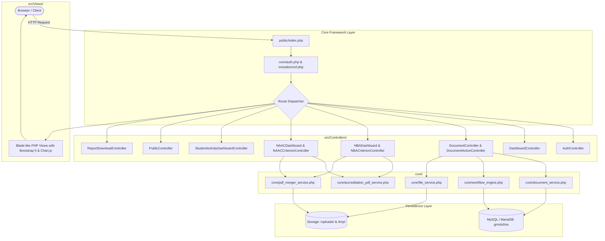
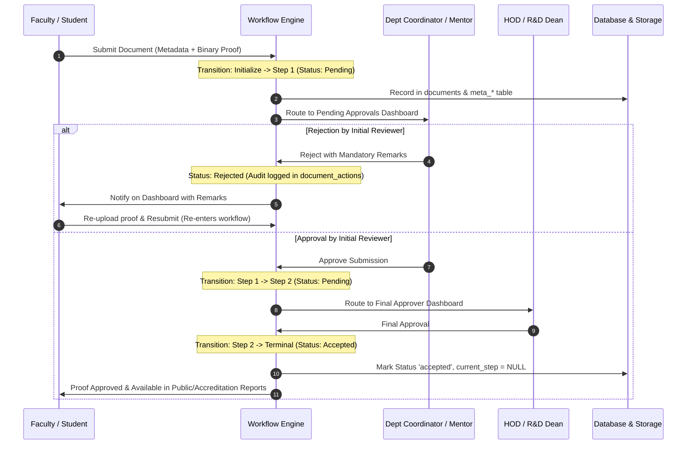
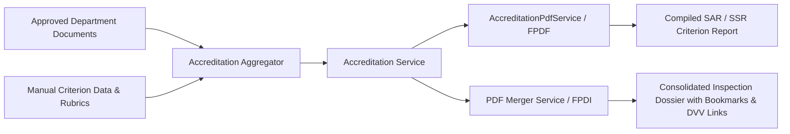

# Project Methodology and Flow Architecture

This document details the operational methodology, architectural structure, and workflow state machines powering the **File Management System (FMS)**.

---

## 1. Project Methodology

The **File Management System (FMS)** is engineered around a **Decoupled MVC Architecture** with a **Data-Driven Workflow Engine**, strict **Role-Based Access Control (RBAC)**, and comprehensive compliance reporting for higher education accreditation bodies (NBA / NAAC).

### 1.1 Architectural Principles
*   **Central Front-Controller Pattern:** All HTTP requests enter through `public/index.php`, where route resolution and request dispatching occur securely without exposing internal core scripts.
*   **Data-Driven Dynamic Workflow:** State transitions (`draft`, `pending`, `accepted`, `rejected`) and approver assignments are configured entirely in relational database tables (`workflows`, `workflow_steps`, `workflow_transitions`, `document_actions`), completely removing hardcoded procedural logic.
*   **Metadata Extensibility:** 21 document categories (Journals, Conferences, Patents, FDPs, Student Activities, etc.) store polymorphic schemas into specialized `meta_*` extension tables referenced through a central `meta_registry.php`.
*   **Multi-Tier Defense-in-Depth:**
    *   Strict CSRF tokens for all state-changing requests, with automatic JSON fallback for AJAX/APIs.
    *   Canonical path bounding with `realpath()` verifying that every streamed file resides within the approved `uploads/` directory.
    *   Strict MIME verification via PHP `finfo` (File Information) rather than untrusted client headers.
    *   Dynamic session security with `HttpOnly`, `SameSite=Lax`, and `Secure` cookie flags.
    *   Comprehensive `.htaccess` execution denial in `uploads/`, `tmp/`, `bin/`, and `database/`.

---

## 2. High-Level System Architecture

---

## 3. Workflow State Machine Lifecycle

Documents move through a transactional state machine managed by `core/workflow_engine.php` under exclusive row locks (`SELECT ... FOR UPDATE`):

---

## 4. Accreditation Module Flow (NBA & NAAC)

Accreditation data compilation bridges departmental documents with institutional SAR/SSR generation:

---

## 5. Technology Stack Summary

| Layer | Implementation |
| :--- | :--- |
| **Language & Runtime** | PHP 8.2+ (strict types, prepared statements, native autoloader) |
| **Database** | MySQL 8.0+ / MariaDB (`utf8mb4` charset, composite covering indexes) |
| **Web Server** | Apache 2.4+ (`mod_rewrite`, `mod_headers`, `.htaccess` isolation) |
| **Frontend** | Vanilla JS (ES6+), Bootstrap 5, FontAwesome 6, Chart.js, Google Fonts (Inter) |
| **Document Generation** | FPDF 1.8x, FPDI 2.6.0 (PDF importing, merging, and stamping) |
| **Security Standards** | OWASP Top 10 aligned: CSRF tokens, strict MIME sniffing, path traversal defenses |
