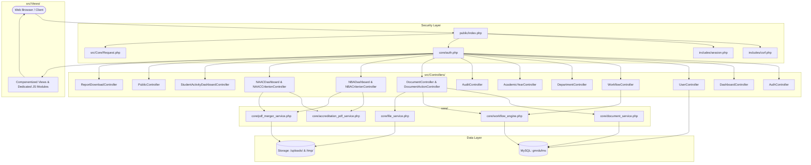
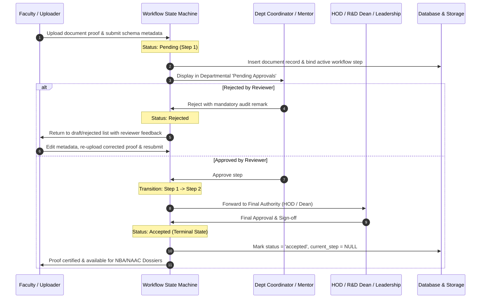

# File Management System (FMS) 🚀

[](https://github.com/Karanam-Gowtham/FMS/actions/workflows/ci.yml)
[](https://sonarcloud.io/summary/new_code?id=Karanam-Gowtham_FMS)
[](https://sonarcloud.io/summary/new_code?id=Karanam-Gowtham_FMS)
[](https://sonarcloud.io/summary/new_code?id=Karanam-Gowtham_FMS)
[](https://sonarcloud.io/summary/new_code?id=Karanam-Gowtham_FMS)
[](https://www.php.net/)
[](https://www.mysql.com/)
[](LICENSE)

A modernized, enterprise-grade academic document lifecycle, governance, and accreditation intelligence platform engineered for **GMR Institute of Technology (GMRIT)**.

The **File Management System (FMS)** centralizes paperless proof-tracking across all academic and administrative units. It unifies faculty research portfolios, student achievement tracking, dynamic multi-tier approval state machines, institutional leadership governance, automated database migrations, and one-click **NBA** and **NAAC** accreditation dossier generation into a hardened, high-performance web platform.

---

## 🌟 Core Capabilities & Highlights

*   **Modernized MVC Architecture:**
    *   All HTTP requests route through a single hardened front controller (`public/index.php`) dispatching to 24 modular, PSR-4 compliant Controllers extending `BaseController`.
    *   Polymorphic typed input sanitization layer via `App\Core\Request` (`getInt`, `getString`, `getEnum`, `getArray`, `getFloat`, `getBool`).
    *   Fully componentized views and decoupled client scripts for peak maintainability and zero inline script clutter.
*   **Dynamic Workflow Engine:**
    *   Configurable approval state machines (`draft` ➔ `pending` ➔ `accepted` / `rejected`) stored in relational tables (`workflows`, `workflow_steps`, `workflow_transitions`).
    *   Runs under strict transactional concurrency with row-level locks (`SELECT ... FOR UPDATE`) to prevent double-approvals or race conditions.
    *   Visual interactive workflow designer with drag-and-drop step sequencing and custom document type routing.
*   **Comprehensive NBA & NAAC Accreditation Suite:**
    *   **NBA (Criteria 1–9):** Automated criterion calculations (student-faculty ratios, faculty retention, cadre ratios, academic performance indices, placement metrics), rubric data capture, and official SAR PDF dossier compilation.
    *   **NAAC (Criteria 1–7):** Qualitative & quantitative metrics synthesis, automated DVV proof-linking, and SSR preparation.
*   **Institutional Student Activities Dashboard:**
    *   Real-time visual tracking of co-curricular and extracurricular student events across delivery modes (Online/Offline/Hybrid) and scopes (Departmental, Institutional, External).
    *   Club participation breakdown, technical domain distribution, and inter-departmental performance rankings powered by Chart.js.
*   **Student Self-Service Portal:**
    *   Dedicated portal for students to submit achievement proofs (certifications, competitions, workshops, publications) tracked through mentor verification and HOD sign-off.
*   **Public Research Analytics Portal:**
    *   An open-access analytics showcase at `/index.php` visualizing faculty publications (Scopus, SCI, UGC Care), patent yields, research funding, top investigator leaderboards, and departmental research velocity.
*   **Automated PDF Dossier Compiler:**
    *   Composer-managed `setasign/fpdf` (`^1.8`) and `setasign/fpdi` (`^2.6`) integration with institutional Cambria font support.
    *   Stamps DVV verification watermarks, normalizes rotated pages, scales multi-format images, and concatenates multi-document proofs into submission-ready inspection dossiers.
*   **Enterprise Security & Defense-in-Depth:**
    *   Session hijacking and fixation mitigation (`session_regenerate_id`, dynamic `SameSite=Lax`, `HttpOnly`, and conditional `Secure` cookie flags).
    *   7,200-second automatic session inactivity timeout with absolute ceiling guards.
    *   Dual-mode CSRF defense (protects standard HTML form submissions and emits clean JSON 403 responses for AJAX/Fetch APIs).
    *   Strict file MIME sniffing with PHP `finfo` (disallowing spoofed extensions) and canonical base directory traversal sandboxing.
    *   RFC 5987 / 6266 `filename*=` Unicode Content-Disposition compliance for international characters in file downloads.
*   **Production CLI & Migration Engine:**
    *   Automated migration runner (`bin/migrate.php`) supporting `--status`, `--run`, and `--baseline` tracking via `schema_migrations`.
    *   Automated pre-flight diagnostic suite (`bin/deploy_check.php`) and architectural consistency auditor (`bin/deep_audit.php`).
*   **Hardened CI/CD & SonarCloud Quality Gate:**
    *   Automated GitHub Actions pipeline with SHA-pinned actions running PHP syntax checks, Composer validation, and SonarCloud scans on every push and pull request.
    *   Maintains SonarCloud Quality Gate **OK (Passed)** with **0 open bugs/vulnerabilities**, **0.2% duplications**, and **Rating A** across Reliability, Security, and Maintainability.

---

## 🛠️ Technology Stack

| Layer | Technologies | Purpose |
| :--- | :--- | :--- |
| **Runtime & Backend** | PHP 8.2+ (Strict Types, Prepared Statements, PSR-4 Autoloading) | Core application, domain services, and business logic |
| **Package Management** | Composer (`composer.json`, `composer.lock`) | PSR-4 autoloading (`App\`), `setasign/fpdf`, `setasign/fpdi` |
| **Database** | MySQL 8.0+ / MariaDB (`utf8mb4` charset) | Relational persistence, covering indexes, foreign keys |
| **Web Server** | Apache 2.4+ (`mod_rewrite`, `mod_headers`, `mod_php`) | URL routing, security headers, directory sandboxing |
| **Frontend Styling** | Modern CSS3 (Custom Glassmorphism, CSS Tokens, Responsive Grid) | Institutional UI, high contrast, clean typography |
| **Frontend Scripting** | Vanilla JavaScript (ES6+ Modules), Chart.js 4.x | Interactive UI modals, async APIs, and dynamic charts |
| **PDF Generation** | FPDF 1.8.2, FPDI 2.6.9, Institutional Cambria Fonts | Vector report synthesis and PDF proof compilation |
| **CI / CD Pipeline** | GitHub Actions (Commit SHA Pinned) | Automated linting, dependency checks, and SonarCloud analysis |
| **Quality & Security** | SonarCloud / SonarQube | Continuous code quality, OWASP Top 10 compliance |

---

## 🔄 System Architecture & Lifecycle

### Architectural Layering



### Document Approval Workflow State Machine



---

## 📂 Project Directory Structure

```text
FMS/
├── .github/
│   └── workflows/
│       └── ci.yml                        # GitHub Actions CI & SonarCloud Pipeline
│
├── public/                               # Public Web Root (All Web Traffic Entry)
│   ├── index.php                         # Central Front Controller & Route Dispatcher
│   ├── view_public_file.php              # Cryptographically Bounded Public File Streamer
│   ├── 403.php                           # Branded HTTP 403 Forbidden Template
│   ├── 404.php                           # Branded HTTP 404 Not Found Template
│   ├── 500.php                           # Branded HTTP 500 Internal Server Error Template
│   ├── api/                              # Lightweight Public Endpoint APIs
│   └── assets/                           # Public Static Web Assets
│
├── src/                                  # PSR-4 Application Source (App\ Namespace)
│   ├── Core/                             # Core Kernel Components
│   │   └── Request.php                   # Polymorphic Typed Request Sanitizer
│   │
│   ├── Controllers/                      # 24 Modular MVC Controllers
│   │   ├── BaseController.php            # Abstract Base Controller (Auth, Flash, CSRF, Views)
│   │   ├── AuthController.php            # Login, Registration, Session, Role Switching
│   │   ├── DashboardController.php       # Role-Aware Aggregation Dashboard
│   │   ├── UserController.php            # User Management, Leadership Assignment & Lifecycle
│   │   ├── WorkflowController.php        # Visual State Machine & Document Routing
│   │   ├── DepartmentController.php      # Academic & Non-Academic Unit Management
│   │   ├── AcademicYearController.php    # Academic Calendar & Cycle Management
│   │   ├── AuditController.php           # College-Wide System Event & Security Audit
│   │   ├── DocumentController.php        # Document Browsing, Search, Filtering & Details
│   │   ├── DocumentActionController.php  # Upload Processing, Approvals, Rejections & Edits
│   │   ├── AbstractAccreditation*        # Reusable Accreditation API & Criterion Bases
│   │   ├── NBA*Controllers.php           # NBA Criteria 1–9 Handlers & SAR Dossiers
│   │   ├── NAAC*Controllers.php          # NAAC Criteria 1–7 Handlers & SSR Dossiers
│   │   ├── StudentActivityDashboard*     # Student Events & Co-Curricular Dashboard
│   │   ├── StudentController.php         # Student Self-Service Submission Portal
│   │   ├── ProfileController.php         # User Profiles & Password Management
│   │   ├── PublicController.php          # Public Institutional Showcase Endpoints
│   │   └── ReportDownloadController.php  # CSV / Excel Report Exporters
│   │
│   └── Views/                            # Componentized Presentation Templates
│       ├── academic_years/               # Academic Year Management Views
│       ├── admin/                        # Admin Governance Views
│       │   ├── users/                    # Decoupled Modal Partials (Add, Assign Roles)
│       │   ├── users.php                 # Faculty & Leadership Table
│       │   ├── workflows.php             # Visual State Machine Configurator
│       │   ├── departments.php           # Academic & Unit Management
│       │   └── audit_logs.php            # Security & System Event Trace
│       ├── auth/                         # Login, Register, Role Selector
│       ├── dashboard/                    # Role-Specific Dashboard Subviews
│       │   ├── admin_section.php         # System Administrator Oversight
│       │   ├── reviewer_section.php      # HOD / Coordinator / Dean Approvals
│       │   ├── faculty_section.php       # Faculty Submissions & Metrics
│       │   └── submissions_table.php     # Paginated Document Action Matrix
│       ├── dashboard.php                 # Master Dynamic Role-Switching Dashboard
│       ├── documents/                    # Upload, Edit, Detail, Master List
│       ├── naac/                         # NAAC Dashboard & Criteria 1–7 Templates
│       ├── nba/                          # NBA Dashboard & Criteria 1–9 Templates
│       ├── partials/                     # Reusable UI Partials
│       │   ├── alerts.php                # Flash Messages (Success, Error, Warning)
│       │   ├── pagination.php            # Universal Accessible Pagination Component
│       │   └── role_switcher.php         # Instant Role Switching Dropdown
│       ├── profile/                      # Profile & Faculty Credentials
│       ├── public/                       # Open Research Analytics Views
│       ├── student/                      # Student Self-Service Submissions
│       └── student_activities/           # Student Activity Institutional Dashboard
│
├── core/                                 # Domain Engines & Reusable Services
│   ├── bootstrap.php                     # Global Autoloader, Exception Handler & Config Init
│   ├── auth.php                          # RBAC Authentication, Session Guards & Role Switching
│   ├── constants.php                     # Role Constants & System Enumerations
│   ├── document_service.php              # Document Query Engine & Metadata Mapping
│   ├── workflow_engine.php               # Dynamic State Machine & Transactional Transitions
│   ├── file_service.php                  # MIME Sniffing, Upload Validation & Stream Download
│   ├── meta_registry.php                 # Registry for 21 Document Schemas
│   ├── accreditation_pdf_service.php     # FPDF Dossier Engine with DVV Stamping
│   └── pdf_merger_service.php            # FPDI PDF & Image Document Consolidation Service
│
├── database/                             # Database Migrations & Schemas
│   ├── clean_production_setup.sql        # Complete All-In-One Production Schema & Seed
│   ├── .htaccess                         # Direct HTTP Access Denial
│   └── migrations/                       # Incremental SQL Migrations (001 through 013)
│       ├── 001_create_target_schema.sql
│       ├── 002_intra_college.sql
│       ├── 002_workflow_state_machine.sql
│       ├── 003_create_gmrdufms.sql
│       ├── 004_create_user_profiles.sql
│       ├── 005_create_nba_tables.sql
│       ├── 006_create_naac_tables.sql
│       ├── 007_alter_document_actions_action_column.sql
│       ├── 008_add_document_status_indexes.sql
│       ├── 009_add_complete_university.sql
│       ├── 010_update_departments_is_academic.sql
│       ├── 011_seed_all_department_accounts.sql
│       ├── 012_create_system_audit_logs.sql
│       └── 013_academic_years_departments_mgmt.sql
│
├── bin/                                  # Command-Line Diagnostic & Maintenance Utilities
│   ├── .htaccess                         # CLI Directory Web Access Denial
│   ├── migrate.php                       # Automated CLI Migration Engine (--status, --run, --baseline)
│   ├── deploy_check.php                  # 26-Point Production Pre-Flight Diagnostic Suite
│   ├── deep_audit.php                    # Architectural Integrity & Route Consistency Scanner
│   ├── deep_code_hunter.php              # Form, CSRF & View Variable Verification Utility
│   └── sql_verifier.php                  # Live SQL Query & Database Column Schema Verifier
│
├── assets/                               # Static Web Assets
│   ├── css/                              # Theme Tokens, Reset & Component Styles
│   ├── fonts/                            # Institutional Cambria TTF & FPDF Metric Files
│   ├── img/                              # Logos, Badges, & Institutional Emblems
│   └── js/                               # Decoupled ES6+ Client Scripts
│       ├── admin_users.js                # Faculty Role & Leadership Modal Logic
│       ├── nba_criterion1.js             # NBA Criterion 1 Calculations
│       ├── nba_criterion3.js             # NBA Criterion 3 Dynamic Tables
│       ├── nba_criterion4.js             # NBA Criterion 4 Student Ratios
│       ├── nba_criterion5.js             # NBA Criterion 5 Faculty Retentions
│       ├── student_activities_charts.js  # Chart.js Visualizations
│       └── student_activity_upload.js    # Interactive Student Upload Validator
│
├── includes/                             # Shared Layout Includes & Connections
│   ├── connection.php                    # MySQLi Connection with JSON API Fallback
│   ├── session.php                       # Secure Session Initialization & Cookie Flags
│   ├── csrf.php                          # Dual-Mode CSRF Token Generation & Validation
│   ├── breadcrumb.php                    # Dynamic Contextual Breadcrumb Builder
│   └── header.php                        # Shared Navigation & Branding Header
│
├── uploads/                              # Physically Uploaded Proofs & Generated PDFs
│   └── .htaccess                         # PHP Script Execution Denial Guard
│
├── tmp/                                  # Scratch Space for PDF Merging
│   └── .htaccess                         # Direct Download Denial Guard
│
├── composer.json                         # Composer Package Definitions & PSR-4 Autoload
├── composer.lock                         # Pinned Dependencies (setasign/fpdf, setasign/fpdi)
├── index.php                             # Root Public Analytics & Publication Portal
├── config.php                            # Dynamic BASE_URL Resolver & Environment Loader
├── .env.example                          # Sample Environment Variables
├── .gitignore                            # Git Exclusion Rules (Excludes /vendor/, /uploads/)
├── sonar-project.properties              # SonarCloud Configuration (Zero Duplications)
└── LICENSE                               # MIT License
```

---

## 🔐 Role-Based Access Control (RBAC)

The system enforces strict multi-role separation across 9 discrete institutional roles:

| Role ID | Role Identifier | System Role Name | Access Scope & Institutional Rules |
| :---: | :--- | :--- | :--- |
| **1** | `ROLE_ADMIN` | Administrator | Full institutional oversight, user management, workflow creation, academic calendar, system audit logs |
| **2** | `ROLE_IQAC` | IQAC Coordinator | College-wide NBA/NAAC oversight, criteria consolidation, quality audits (*Strictly 1 holder college-wide*) |
| **3** | `ROLE_HOD` | Head of Department | Final departmental approvals, faculty portfolios, SAR review (*Strictly 1 active HOD per department*) |
| **4** | `ROLE_FACULTY` | Faculty | Upload research, FDPs, patents; track approval status, view personal history |
| **5** | `ROLE_DEPT_COORDINATOR` | Dept Coordinator | Initial departmental document review, proof verification, forward to HOD |
| **6** | `ROLE_CENTRAL_COORDINATOR`| Central Coordinator| College-wide event coordination (NSS, Sports, Clubs, Professional Bodies) (*Strictly 1 holder college-wide*) |
| **7** | `ROLE_JUNIOR_ASSISTANT` | Junior Assistant | Departmental administrative uploads and clerical document indexing |
| **8** | `ROLE_RND_DEAN` | R&D Dean | Research document oversight (Journals, Conferences, Patents, Grants) (*Strictly 1 holder college-wide*) |
| **9** | `ROLE_STUDENT` | Student | Student achievement uploads, certification tracking, mentor approvals |

*   **Multi-Role User Switching:** Users with multiple roles (e.g., a Faculty member who also serves as an HOD or IQAC Coordinator) can switch roles instantly in real time via `route=auth/select_role` or the persistent header role dropdown.
*   **Department Fencing:** Department Coordinators and HODs are fenced to their assigned department's submissions. College-wide leadership (`ROLE_ADMIN`, `ROLE_IQAC`, `ROLE_RND_DEAN`, `ROLE_CENTRAL_COORDINATOR`) have permission to inspect records across all academic and administrative branches.
*   **Safe Account Lifecycle:** Inactive/relieved faculty accounts are safely archived without deleting their document audit history. Permanent deletion is strictly restricted to test accounts with 0 uploaded records.

---

## 💾 Database Architecture & Migrations

The database `gmrdufms` utilizes standard **InnoDB** storage with strict `utf8mb4` encoding:

*   **Core Authentication & RBAC:** `users`, `roles`, `user_roles`, `user_profiles`, `departments`, `academic_years`, `system_audit_logs`.
*   **Document Management & Audit Trail:**
    *   `documents`: Unified document entity with foreign keys to `uploaded_by`, `dept_id`, `type_id`, `academic_year_id`, `status`, and `current_step`.
    *   `document_files`: Stores physical file paths, original names, MIME types, and file sizes.
    *   `document_actions`: Complete transactional audit trail of every submission, approval, rejection, and comment.
*   **Workflow State Machine:** `workflows`, `workflow_steps`, `workflow_transitions`, `document_types`.
*   **Accreditation Tables:** `nba_submissions`, `nba_criteria_data`, `naac_submissions`, `naac_criteria_data`.
*   **21 Domain-Specific Metadata Schemas:** `meta_journal`, `meta_conference`, `meta_patent`, `meta_fdp_attended`, `meta_fdp_organised`, `meta_student_activity_file`, `meta_student_body`, `meta_student_event`, `meta_student_journal`, etc.
*   **Covering Indexes:** High-frequency lookup optimization via composite index `idx_dept_status (dept_id, status)` and single index `idx_status (status)` on `documents`.

### CLI Migration Engine

The platform includes an automated migration tool at `bin/migrate.php`:

```bash
# View all available and applied migrations
php bin/migrate.php --status

# Automatically execute all pending SQL migrations
php bin/migrate.php --run

# Mark all existing migrations as applied (useful when importing a raw SQL dump)
php bin/migrate.php --baseline
```

---

## 🚀 Installation & Deployment Guide

### Prerequisites
*   **PHP:** Version 8.2 or higher
*   **PHP Extensions:** `mysqli`, `fileinfo`, `mbstring`, `session`, `json`, `zip`, `curl`
    *(In Windows XAMPP, ensure `extension=zip` and `extension=fileinfo` are enabled in `php.ini`)*
*   **Composer:** Version 2.x
*   **Database:** MySQL 8.0+ or MariaDB 10.4+
*   **Web Server:** Apache 2.4+ with `mod_rewrite` and `mod_headers` enabled

---

### Local Development Setup (Windows / Linux)

1.  **Clone the Repository:**
    ```bash
    git clone https://github.com/Karanam-Gowtham/FMS.git
    # On Windows XAMPP: C:/xampp/htdocs/FMS (or E:/set/xampp/htdocs/mini/FMS)
    ```

2.  **Install Composer Dependencies:**
    ```bash
    composer install --no-dev --optimize-autoloader
    ```

3.  **Create and Populate Database:**
    Open MySQL CLI or phpMyAdmin:
    ```sql
    CREATE DATABASE gmrdufms CHARACTER SET utf8mb4 COLLATE utf8mb4_unicode_ci;
    ```
    Option A (One-File Clean Production Setup):
    ```bash
    mysql -u root -p gmrdufms < database/clean_production_setup.sql
    php bin/migrate.php --baseline
    ```
    Option B (Incremental Migrations):
    ```bash
    mysql -u root -p gmrdufms < database/migrations/003_create_gmrdufms.sql
    php bin/migrate.php --run
    ```

4.  **Configure Environment (`.env`):**
    Copy the sample configuration file:
    ```bash
    cp .env.example .env
    ```
    Configure your database credentials and base URL:
    ```ini
    APP_ENV=development
    APP_DEBUG=true
    DB_HOST=localhost
    DB_PORT=3306
    DB_NAME=gmrdufms
    DB_USER=root
    DB_PASS=
    # Note: config.php automatically resolves BASE_URL dynamically if omitted!
    SESSION_TIMEOUT=7200
    ```

5.  **Run Pre-Flight Integrity Diagnostics:**
    ```bash
    php bin/deploy_check.php
    php bin/deep_audit.php
    ```

---

### Remote Server Deployment (Windows XAMPP)

When deploying updates to a live or remote Windows XAMPP server (e.g. `C:\xampp\htdocs\FMS`):

1.  **Pull the Latest Code:**
    ```cmd
    cd C:\xampp\htdocs\FMS
    git pull origin main
    ```

2.  **Install / Update Composer Dependencies:**
    ```cmd
    C:\xampp\php\php.exe composer.phar install --no-dev --optimize-autoloader
    ```
    *(If Composer is installed globally in PATH, simply run `composer install --no-dev --optimize-autoloader`)*

3.  **Run Database Migrations:**
    ```cmd
    C:\xampp\php\php.exe bin/migrate.php --status
    C:\xampp\php\php.exe bin/migrate.php --run
    ```

4.  **Restart Apache:**
    In the XAMPP Control Panel, click **Stop** then **Start** on **Apache** to flush PHP OPcache.

5.  **Access the Application:**
    Navigate to `http://localhost/FMS` (or `http://<SERVER-IP>/FMS`).
    Sign in with administrative credentials:
    *   **Email:** `admin@gmrit.edu.in`
    *   **Password:** `Admin@123`

---

## 🔒 Security Best Practices Implemented

*   **HTTP Strict Headers:** Root `.htaccess` automatically enforces:
    *   `X-Content-Type-Options: nosniff`
    *   `X-Frame-Options: SAMEORIGIN`
    *   `X-XSS-Protection: 1; mode=block`
    *   `Referrer-Policy: strict-origin-when-cross-origin`
*   **Directory Sandboxing:** Direct browser access to internal directories (`/core/`, `/src/`, `/database/`, `/bin/`, `/tmp/`) is blocked with HTTP 403 Forbidden.
*   **Uploads Execution Guard:** The `/uploads/` directory includes an `.htaccess` rule enforcing `RemoveHandler .php .phtml .php3 .php4 .php5 .php7 .php8` and `php_flag engine off`, neutralizing script execution attacks.
*   **Prepared Statements Everywhere:** All database interactions in `src/Controllers/` and `core/` use prepared statements with strict parameter binding (`$stmt->bind_param(...)`) or explicit integer casting.
*   **Cryptographic Timing Attack Prevention:** Passwords use standard `PASSWORD_BCRYPT`. When invalid accounts are requested during login, a dummy `password_verify()` cycle executes to eliminate user enumeration side-channels.
*   **Transactional Integrity:** Critical workflow and user operations run inside database transactions (`$conn->begin_transaction()`, `$conn->commit()`, `$conn->rollback()`).

---

## 🧪 Quality Assurance & CI/CD Pipeline

The project adheres to continuous quality verification enforced via GitHub Actions and SonarCloud:

*   **Syntax & PSR Compliance:** Every PHP file in `src/`, `core/`, `includes/`, `public/`, and `bin/` passes strict `php -l` linting in CI.
*   **Zero Duplication Standard:** SonarCloud duplication density is held at **0.2%** (well below the 3.0% threshold).
*   **Zero Open Vulnerabilities:** Maintained clean of critical security hotspots and code smells.
*   **Regression Suite:** Custom CLI integration test harnesses verify all controller state transitions, role switches, CSRF rejections, and PDF compilation pipelines before release.

---

## ⚖️ License & Attribution

This project is licensed under the MIT License - see the [LICENSE](LICENSE) file for details.  
Architected and developed for institutional governance and accreditation at **GMR Institute of Technology**.
