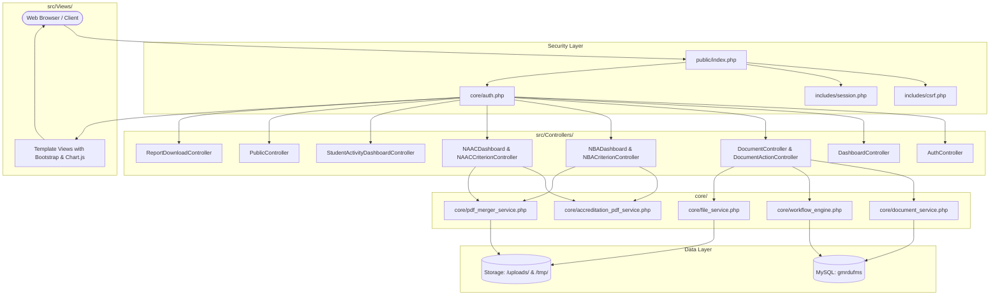
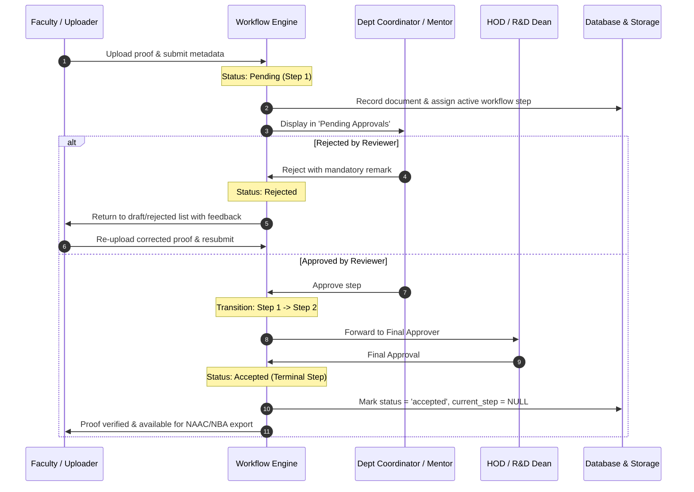

# File Management System (FMS) 🚀

[](https://www.php.net/)
[](https://www.mysql.com/)
[](https://www.sonarqube.org/)
[](https://owasp.org/)
[](LICENSE)

A high-performance, enterprise-grade academic document lifecycle and accreditation management platform engineered for **GMR Institute of Technology (GMRIT)**. 

The **File Management System (FMS)** eliminates paper proof-tracking by providing a unified, role-governed digital repository. It automates institutional workflows—from faculty research and student achievement submissions to multi-tier departmental review, campus-wide analytics, and one-click **NBA** and **NAAC** accreditation dossier generation.

---

## 🌟 Core Capabilities & Highlights

*   **Unified MVC Architecture:** All HTTP requests route through a single hardened front-controller (`public/index.php`) dispatching to 19 dedicated Controllers.
*   **Data-Driven Workflow Engine:** Multi-step approval chains (`draft` ➔ `pending` ➔ `accepted` / `rejected`) configured dynamically in relational tables, running under transactional row-level locks (`SELECT ... FOR UPDATE`).
*   **Comprehensive NBA & NAAC Accreditation Suite:**
    *   **NBA (Criteria 1–9):** Automated criterion calculations, rubric data entry, and official SAR PDF report generation.
    *   **NAAC (Criteria 1–7):** Qualitative & quantitative metrics compilation, DVV proof-linking, and SSR preparation.
*   **Institutional Student Activities Dashboard:** Real-time visual tracking of student events across delivery modes (Online/Offline/Hybrid), event scopes (Departmental, Campus-Wide, External), technical domains, active clubs, and departmental participation rankings.
*   **Student Self-Service Portal:** Role-specific portal for students to submit co-curricular and extra-curricular proofs, tracked through faculty mentor verification.
*   **Public Research Analytics Portal:** An open-access dashboard at `/index.php` visualizing faculty publications, patent yields, top researcher rankings, and department distribution with interactive Chart.js graphs.
*   **Automated PDF Dossier Compiler:** Built-in PDF merger and FPDF/FPDI generation service that normalizes, stamps, fits images, and compiles multi-document proofs into submission-ready inspection dossiers.
*   **Enterprise Security & Defense-in-Depth:**
    *   Session hijacking and fixation mitigation (`session_regenerate_id`, dynamic `SameSite=Lax`, `HttpOnly`, and conditional `Secure` cookies).
    *   7200-second automatic session inactivity timeout.
    *   Dual-mode CSRF defense (protects both standard HTML form submissions and emits clean JSON 403 responses for AJAX/Fetch APIs).
    *   Strict file MIME sniffing with PHP `finfo` (disallowing spoofed extensions) and canonical base directory traversal sandboxing.
    *   RFC 5987 / 6266 `filename*=` Unicode Content-Disposition compliance for international characters in file downloads.
*   **Diagnostic CLI Suite:** Automated pre-flight check (`bin/deploy_check.php`) and deep integrity audit (`bin/deep_audit.php`) to verify runtime readiness before deployment.

---

## 🛠️ Technology Stack

| Layer | Technologies | Purpose |
| :--- | :--- | :--- |
| **Runtime & Backend** | PHP 8.2+ (Strict Types, Prepared Statements, PSR Autoloading) | Core application and business logic |
| **Database** | MySQL 8.0+ / MariaDB (`utf8mb4` charset) | Relational persistence, covering indexes |
| **Web Server** | Apache 2.4+ (`mod_rewrite`, `mod_headers`, `mod_php`) | URL rewriting and directory sandboxing |
| **Frontend Styling** | CSS3 (Custom Glassmorphism, Responsive Grid, Modern Tokens) | Premium UI, dark & light palettes |
| **Frontend Scripting** | Vanilla JavaScript (ES6+), Chart.js 4.x | Lightweight logic and dynamic visualizations |
| **PDF Generation** | FPDF 1.8x, FPDI 2.6.0 | Report synthesis and proof consolidation |
| **Quality & Audit** | SonarQube / SonarCloud | Code reliability, security, and maintainability |

---

## 🔄 System Architecture & Lifecycle

### Architectural Layering



### Document Approval Workflow



---

## 📂 Project Directory Structure

```text
FMS/
├── public/                               # Public Web Root
│   ├── index.php                         # Central Front Controller & Route Dispatcher
│   ├── view_public_file.php              # Cryptographically Bounded Public File Streamer
│   ├── 403.php                           # Branded HTTP 403 Forbidden Template
│   ├── 404.php                           # Branded HTTP 404 Not Found Template
│   ├── 500.php                           # Branded HTTP 500 Internal Server Error Template
│   ├── api/                              # Lightweight Public Endpoint APIs
│   └── assets/                           # Public Static CSS, JS, and Images
│
├── src/                                  # Application Source Code
│   ├── Controllers/                      # MVC Endpoint Controllers (19 total)
│   │   ├── AbstractAccreditationAPIController.php
│   │   ├── AbstractAccreditationCriterionController.php
│   │   ├── AbstractAccreditationDashboardController.php
│   │   ├── AcademicYearController.php
│   │   ├── AuthController.php
│   │   ├── DashboardController.php
│   │   ├── DocumentActionController.php
│   │   ├── DocumentController.php
│   │   ├── NAACAPIController.php
│   │   ├── NAACCriterionController.php
│   │   ├── NAACDashboardController.php
│   │   ├── NBAAPIController.php
│   │   ├── NBACriterionController.php
│   │   ├── NBADashboardController.php
│   │   ├── ProfileController.php
│   │   ├── PublicController.php
│   │   ├── ReportDownloadController.php
│   │   ├── StudentActivityDashboardController.php
│   │   └── StudentController.php
│   │
│   └── Views/                            # User Interface Presentation Templates
│       ├── academic_years/               # Academic Year Configuration Views
│       ├── auth/                         # Login, Register, Role Selector
│       ├── documents/                    # Upload, Edit, View, My Uploads, Master List
│       ├── naac/                         # NAAC Dashboard & Criteria 1–7 Views
│       ├── nba/                          # NBA Dashboard & Criteria 1–9 Views
│       ├── partials/                     # Reusable Navigation, Sidebar, Flash Messages
│       ├── profile/                      # User Profile & Security Settings
│       ├── public/                       # Public Department & Research Views
│       ├── student/                      # Student Dashboard & Achievement Upload
│       ├── student_activities/           # Student Activity Institutional Dashboard
│       └── dashboard.php                 # Unified Role-Based Home Dashboard
│
├── core/                                 # Domain Engines & Reusable Services
│   ├── bootstrap.php                     # Global Autoloader, Exception Handler & Config Init
│   ├── auth.php                          # RBAC Authentication, Session Guards & Role Switching
│   ├── constants.php                     # Role Constants & System Enumerations
│   ├── document_service.php              # Document Query Engine & Metadata Mapping
│   ├── workflow_engine.php               # Dynamic State Machine & Transactional Transitions
│   ├── file_service.php                  # MIME Sniffing, Upload Validation & Stream Download
│   ├── meta_registry.php                 # Registry for 21 Document Schemas
│   ├── accreditation_pdf_service.php     # FPDF Dossier Engine with DVV Stamping
│   └── pdf_merger_service.php            # FPDI PDF & Image Document Consolidation Service
│
├── database/                             # Database Migrations & Schemas
│   ├── .htaccess                         # Direct HTTP Access Denial
│   └── migrations/                       # Incremental SQL Migrations (001 through 008)
│       ├── 001_create_target_schema.sql
│       ├── 002_intra_college.sql
│       ├── 002_workflow_state_machine.sql
│       ├── 003_create_gmrdufms.sql
│       ├── 004_create_user_profiles.sql
│       ├── 005_create_nba_tables.sql
│       ├── 006_create_naac_tables.sql
│       ├── 007_alter_document_actions_action_column.sql
│       └── 008_add_document_status_indexes.sql
│
├── bin/                                  # Command-Line Diagnostic & Maintenance Utilities
│   ├── .htaccess                         # CLI Directory Web Access Denial
│   ├── deploy_check.php                  # 26-Point Production Pre-Flight Diagnostic Suite
│   ├── deep_audit.php                    # 10-Suite Architectural Integrity & Consistency Scanner
│   ├── deep_code_hunter.php              # Form, CSRF & View Variable Verification Utility
│   └── sql_verifier.php                  # Live SQL Query & Database Column Schema Verifier
│
├── includes/                             # Shared Layout Includes & Connections
│   ├── connection.php                    # MySQLi Database Connection with JSON API Fallback
│   ├── session.php                       # Secure Session Initialization & Cookie Flags
│   ├── csrf.php                          # Dual-Mode CSRF Token Generation & Validation
│   ├── breadcrumb.php                    # Dynamic Contextual Breadcrumb Builder
│   └── header.php                        # Shared Navigation & Branding Header
│
├── libs/                                 # Third-Party Bundled Libraries
│   ├── fpdf.php                          # FPDF 1.84 Library
│   └── fpdi/                             # Setasign FPDI 2.6.0 PDF Parser
│
├── uploads/                              # Physically Uploaded Proofs & Generated PDFs
│   └── .htaccess                         # PHP Script Execution Denial Guard
│
├── tmp/                                  # Scratch Space for PDF Merging
│   └── .htaccess                         # Direct Download Denial Guard
│
├── index.php                             # Root Public Analytics & Publication Portal
├── config.php                            # Environment Loader & Global Constants
├── .env.example                          # Sample Environment Variables
├── .gitignore                            # Git Exclusion Rules
├── sonar-project.properties              # SonarQube Static Code Analysis Configuration
└── LICENSE                               # MIT License
```

---

## 🔐 Role-Based Access Control (RBAC)

The system enforces strict multi-role separation across 9 discrete institutional roles:

| Role ID | Role Identifier | System Role Name | Access Scope & Capabilities |
| :---: | :--- | :--- | :--- |
| **1** | `ROLE_ADMIN` | Admin | Full institutional oversight, user administration, system-wide documents |
| **2** | `ROLE_IQAC` | IQAC Coordinator | Campus-wide NAAC/NBA monitoring, criteria consolidation, quality reports |
| **3** | `ROLE_HOD` | Head of Department | Final departmental approvals, department faculty analytics, SAR review |
| **4** | `ROLE_FACULTY` | Faculty | Upload research, FDPs, patents; track approval status, view personal history |
| **5** | `ROLE_DEPT_COORD`| Dept Coordinator | Initial document review, proof verification, forward to HOD |
| **6** | `ROLE_CENTRAL_COORD`| Central Coordinator| College-wide event coordination (NSS, Sports, Clubs, Professional Bodies) |
| **7** | `ROLE_JR_ASSIST` | Junior Assistant | Academic year documentation, administrative proof entry |
| **8** | `ROLE_RND_DEAN`  | R&D Dean | Research document oversight (Journals, Conferences, Patents, Grants) |
| **9** | `ROLE_STUDENT`   | Student | Student achievement uploads, certification tracking, mentor approvals |

*   **Multi-Role User Switching:** Users holding multiple roles (e.g., a Faculty member who also serves as an IQAC Coordinator) can seamlessly switch roles in real time via `route=auth/select_role`.
*   **Smart Department Fencing:** All document listings and approval actions are securely bounded. Department coordinators and HODs only see records belonging to their authorized department, while college-wide leadership (Admin, R&D Dean, IQAC) can access all departments.

---

## 💾 Database Schema

The database `gmrdufms` utilizes standard **InnoDB** storage with strict `utf8mb4` encoding:

*   **Core Authentication & RBAC:** `users`, `roles`, `user_roles`, `user_profiles`, `departments`, `academic_years`.
*   **Documents & Storage:**
    *   `documents`: Unified document entity with foreign keys to `uploaded_by`, `dept_id`, `type_id`, `academic_year_id`, `status`, and `current_step`.
    *   `document_files`: Stores physical file paths, original names, MIME types, and file sizes.
    *   `document_actions`: Complete transactional audit trail of every submission, approval, rejection, and comment.
*   **Workflow Engine:** `workflows`, `workflow_steps`, `workflow_transitions`, `document_types`.
*   **Accreditation Tables:** `nba_submissions`, `nba_criteria_data`, `naac_submissions`, `naac_criteria_data`.
*   **Specialized Metadata Tables:** `meta_journal`, `meta_conference`, `meta_patent`, `meta_fdp_attended`, `meta_fdp_organised`, `meta_student_activity_file`, `meta_student_body`, `meta_student_event`, `meta_student_journal`, etc.
*   **Covering Indexes:** High-frequency lookup optimization via composite index `idx_dept_status (dept_id, status)` and single index `idx_status (status)` on `documents`.

---

## 🚀 Installation & Setup

### Prerequisites
*   **PHP:** Version 8.2 or higher
*   **PHP Extensions:** `mysqli`, `fileinfo`, `mbstring`, `session`, `json`, `zip`, `curl`
*   **Database:** MySQL 8.0+ or MariaDB 10.4+
*   **Web Server:** Apache 2.4+ with `mod_rewrite` and `mod_headers` enabled (XAMPP on Windows or native Apache/Nginx on Linux)

### Step-by-Step Installation

1.  **Clone the Repository:**
    ```bash
    git clone https://github.com/Karanam-Gowtham/FMS.git
    # On Windows XAMPP, place into: E:/xampp/htdocs/mini/FMS
    ```

2.  **Create and Populate Database:**
    Open MySQL CLI or phpMyAdmin:
    ```sql
    CREATE DATABASE gmrdufms CHARACTER SET utf8mb4 COLLATE utf8mb4_unicode_ci;
    ```
    Import the baseline schema and migrations in order:
    ```bash
    mysql -u root -p gmrdufms < database/migrations/003_create_gmrdufms.sql
    mysql -u root -p gmrdufms < database/migrations/004_create_user_profiles.sql
    mysql -u root -p gmrdufms < database/migrations/005_create_nba_tables.sql
    mysql -u root -p gmrdufms < database/migrations/006_create_naac_tables.sql
    mysql -u root -p gmrdufms < database/migrations/007_alter_document_actions_action_column.sql
    mysql -u root -p gmrdufms < database/migrations/008_add_document_status_indexes.sql
    ```

3.  **Configure Environment:**
    Copy the sample configuration file:
    ```bash
    cp .env.example .env
    ```
    Edit `.env` (or configure `config.php`) with your local environment settings:
    ```ini
    APP_ENV=production
    APP_DEBUG=false
    DB_HOST=localhost
    DB_PORT=3306
    DB_NAME=gmrdufms
    DB_USER=root
    DB_PASS=
    BASE_URL=http://localhost/mini/FMS
    SESSION_TIMEOUT=7200
    ```

4.  **Run Pre-Flight Diagnostic Checks:**
    Execute the automated pre-flight checker via CLI to confirm complete environment readiness:
    ```bash
    php bin/deploy_check.php
    ```
    Expected output: `STATUS: ALL PRE-FLIGHT CHECKS PASSED. SYSTEM IS PRODUCTION READY!`

5.  **Run Deep Integrity Audit:**
    Verify all routes, roles, workflows, and database tables are in sync:
    ```bash
    php bin/deep_audit.php
    ```
    Expected output: `SUCCESS: 0 BUGS, 0 MISMATCHES, 0 ROUTING ISSUES FOUND!`

6.  **Access the Application:**
    Open your browser and navigate to:
    *   **Public Portal:** `http://localhost/mini/FMS/index.php`
    *   **Login & Staff Portal:** `http://localhost/mini/FMS/public/index.php?route=auth/login`

---

## 🔒 Security Best Practices Implemented

*   **HTTP Strict Headers:** Root `.htaccess` automatically applies `X-Content-Type-Options: nosniff`, `X-Frame-Options: SAMEORIGIN`, `X-XSS-Protection: 1; mode=block`, and `Referrer-Policy: strict-origin-when-cross-origin`.
*   **Directory Sandboxing:** Direct web browser access to `/core/`, `/src/`, `/database/`, `/bin/`, and `/tmp/` is blocked with HTTP 403 Forbidden.
*   **Uploads Execution Guard:** The `/uploads/` directory contains an `.htaccess` rule enforcing `RemoveHandler .php .phtml .php3 .php4 .php5 .php7 .php8` and `php_flag engine off`, ensuring that even if an attacker uploads a malicious script, it cannot be executed.
*   **Zero Raw SQL Interpolation:** All queries in `src/Controllers/` and `core/` utilize prepared statements with strict parameter binding (`$stmt->bind_param(...)`) or whitelisted integer casting.
*   **Password Storage:** Passwords are hashed using standard `PASSWORD_BCRYPT`. When a non-existent user identifier is submitted during authentication, a dummy `password_verify()` cycle executes to eliminate user-enumeration side-channel timing attacks.

---

## ⚖️ License & Attribution

This project is licensed under the MIT License - see the [LICENSE](LICENSE) file for details.  
Developed for institutional governance and accreditation at **GMR Institute of Technology**.
